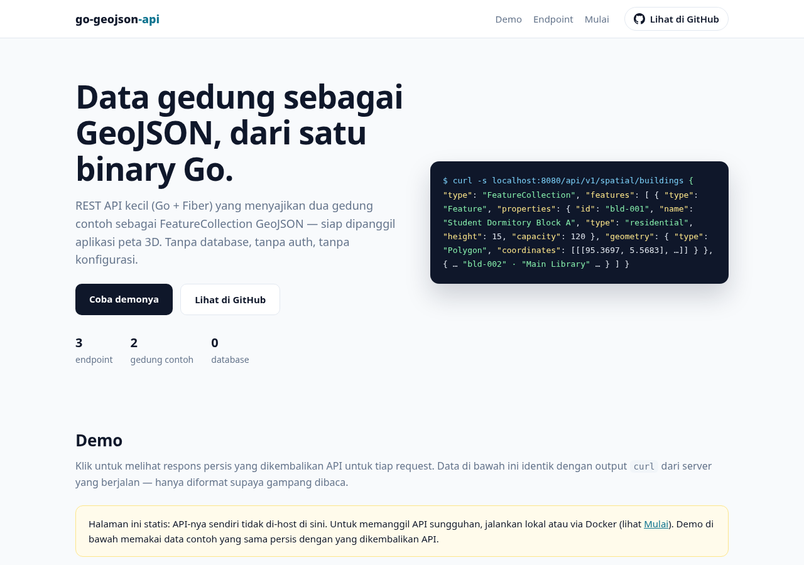
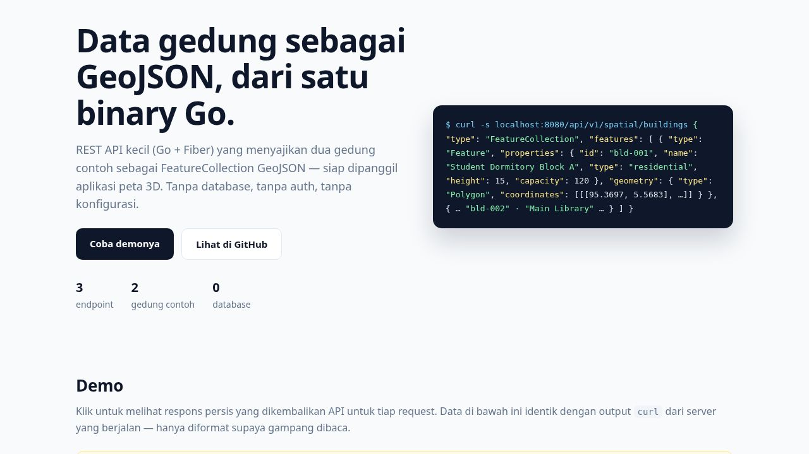

# go-geojson-api

REST API kecil berbahasa Go (Fiber v2) yang menyajikan data gedung dalam
format GeoJSON — dibuat sebagai data contoh untuk rendering peta 3D.

Data yang disajikan adalah **mock statis**: dua gedung contoh
(`Student Dormitory Block A` dan `Main Library`) dengan koordinat contoh di
kawasan Darussalam, Banda Aceh. API ini **tidak punya database**, tidak
membaca file eksternal, dan tidak butuh autentikasi. Cocok sebagai backend
contoh untuk aplikasi peta, atau sebagai titik awal API spasial sungguhan.

> Demo interaktif (pakai data contoh yang sama persis dengan yang
> dikembalikan API) + dokumentasi lengkap:
> **https://go-geojson-api.pages.dev**
>
> Status: **berjalan** — endpoint di bawah ini sudah diuji langsung
> (lihat [`demo-output.txt`](./demo-output.txt) untuk output verbatim).

## Endpoint

| Method | Path | Keterangan |
|---|---|---|
| `GET` | `/` | Indeks API: nama, versi, daftar endpoint |
| `GET` | `/api/v1/health` | Health check → `{"status":"healthy"}` |
| `GET` | `/api/v1/spatial/buildings` | FeatureCollection GeoJSON, 2 gedung |
| `GET` | `/api/v1/spatial/buildings?type=residential` | Hanya gedung `residential` |
| `GET` | `/api/v1/spatial/buildings?type=academic` | Hanya gedung `academic` |

Filter `type` yang tidak cocok dengan gedung mana pun mengembalikan
`"features": []` (array kosong, tetap GeoJSON valid). Route yang tidak
dikenal mengembalikan HTTP 404.

## Contoh

```bash
$ curl -s localhost:8080/api/v1/health
{"status":"healthy"}

$ curl -s "localhost:8080/api/v1/spatial/buildings?type=residential"
{"features":[{"geometry":{"coordinates":[[[95.3697,5.5683],[95.3699,5.5683],[95.3699,5.5681],[95.3697,5.5681],[95.3697,5.5683]]],"type":"Polygon"},"properties":{"capacity":120,"height":15,"id":"bld-001","name":"Student Dormitory Block A","type":"residential"},"type":"Feature"}],"type":"FeatureCollection"}
```

Respons lengkap (semua gedung, tanpa filter) ada di
[`demo-output.txt`](./demo-output.txt).

## Cara menjalankan

Butuh Go 1.26+ (diuji dengan Go 1.27).

```bash
# Clone & jalankan
git clone https://github.com/dezzorigin/go-geojson-api.git
cd go-geojson-api
go run .
# Server jalan di http://localhost:8080

# Port lain
PORT=9000 go run .

# Build binary
go build -o go-geojson-api .
./go-geojson-api
```

### Docker

```bash
docker build -t go-geojson-api .
docker run -p 8080:8080 go-geojson-api
curl -s localhost:8080/api/v1/health
# {"status":"healthy"}
```

## Struktur proyek

```
.
├── main.go            # bootstrap: baca PORT, jalankan server
├── app.go             # newApp(): route + middleware
├── geojson.go         # data gedung contoh + handler /spatial/buildings
├── main_test.go       # tes endpoint (health, filter, 404, ...)
├── Dockerfile         # multi-stage build (Go 1.27 → Alpine)
├── landing/           # halaman dokumentasi statis (Cloudflare Pages)
│   └── index.html
├── docs/
│   ├── api.md         # referensi endpoint
│   ├── architecture.md
│   ├── deployment.md  # cara deploy (binary, Docker, Pages)
│   ├── diagram.svg    # diagram arsitektur
│   ├── demo.mp4       # video demo (terminal + landing)
│   └── screenshots/   # screenshot landing + terminal
├── .github/workflows/ci.yml   # gofmt + vet + test + build + Docker + HTML
├── .gitignore
├── LICENSE            # MIT
└── PRD.md
```

## Batasan (jujur)

- **Data mock, bukan data nyata.** Dua gedung di atas hardcode di
  `geojson.go`; tidak ada database, tidak ada endpoint tulis (POST/PUT/
  DELETE), tidak ada autentikasi/rate limiting.
- **Koordinat contoh.** Poligon gedung adalah kotak contoh di sekitar
  Darussalam, Banda Aceh — bukan hasil survei.
- **Tidak ada hosting API live.** Halaman dokumentasi di Cloudflare Pages
  bersifat statis; demonya memakai data contoh yang sama persis dengan
  respons API. Untuk mencoba API sungguhan, jalankan lokal atau via Docker
  seperti di atas.
- CORS terbuka (`AllowOrigins: "*"`).

## Screenshot & video demo



[](docs/demo.mp4)

Video demo (tanpa suara): menjalankan server, memanggil semua endpoint
via curl, lalu membuka halaman dokumentasi. Rekaman terminal adalah output
verbatim dari sesi yang sebenarnya.

## Pengembangan

```bash
go vet ./...          # static check
go test -race ./...   # tes (coverage ±77%)
gofmt -l .            # harus kosong
```

CI (GitHub Actions) menjalankan: `gofmt` + `go vet` + `go test -race` +
`go build` + `docker build` + smoke test container + `html-validate`
untuk landing page.

## Lisensi

MIT — lihat [LICENSE](./LICENSE).
